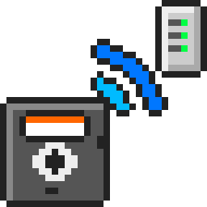
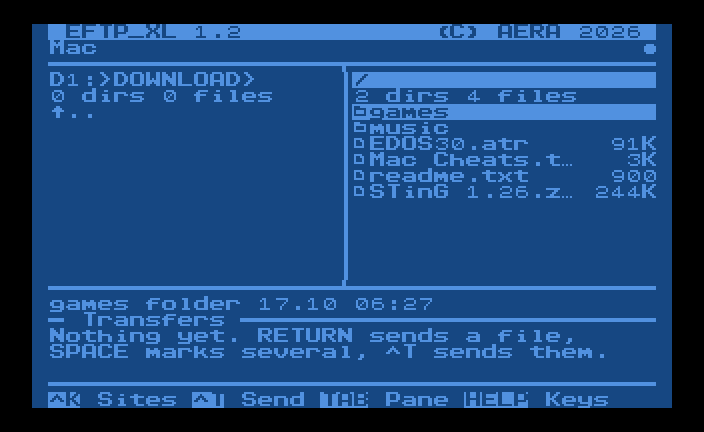
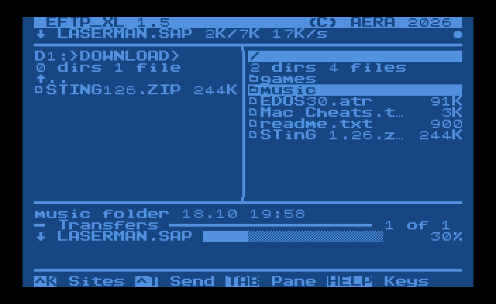
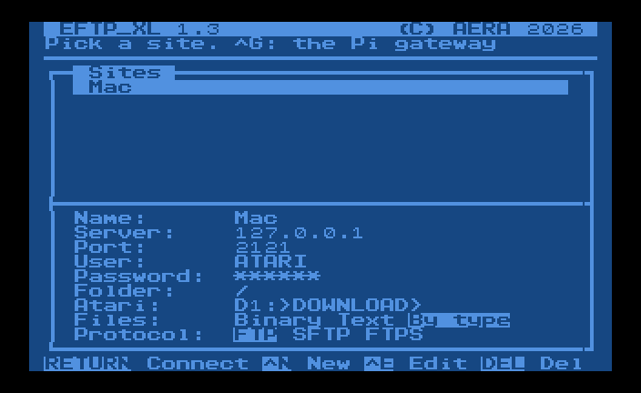

# EFTP_XL



File transfer for 8-bit Atari computers (400/800/XL/XE) over
[FujiNet](https://fujinet.online): two panes, the Atari's drives on
the left and an FTP server (a Mac, a NAS, a Linux box) on the right.
It runs in 48K, on DOS 2.5 or SpartaDOS 3.x.

## Highlights

- Log in to any FTP server with your user and password, over FujiNet
- SFTP and FTPS servers on the internet too, through AERA-Gateway
- Two panes: the Atari (D1:-D8:, SpartaDOS folders) and the server
- Files both ways, marked ones one after the other, with progress and speed
- Whole folders both ways, with everything in them
- Text files with their line ends changed, by type or per site
- Replace? Y/N/All when a file is there already; ESC stops
- New folder, rename and delete on both sides
- Up to 8 sites, saved on the disk; RESET comes back to the main screen
- 6502 assembly for Mac/65: it builds on the Atari too

| | | |
|---|---|---|
|  |  |  |
| Connected: the Atari's folder and the server's | A folder coming down, one file after the other | The sites, saved in `EFTPXL.CFG` |

## Getting started

Download the [latest release](https://github.com/whomper/EFTP_XL/releases):

| File | What it is |
|---|---|
| `EFTPXL.COM` | the program |
| `AERA.FNT` | the AERA font, with its icons (optional) |
| `EFTPXL.ATR` | a bootable SpartaDOS 3.2 disk with both, and the sources |
| `EFTPTEST.ATR` | the test disk, with the test plan |

1. Copy `EFTPXL.COM` and `AERA.FNT` to a disk the Atari can read (an
   ATR on the FujiNet SD card or a TNFS share), or boot `EFTPXL.ATR`.
2. Load it: `L` from the DOS 2.5 menu, or `EFTPXL.COM` at the SpartaDOS
   prompt.
3. ^K for the sites, ^N to add one (server, port, user, password), then
   RETURN on it connects. RETURN sends a file; SPACE marks several and
   ^T sends them; HELP shows the keys.

It needs an Atari with 48K, FujiNet (firmware 1.3 or later) and a DOS
whose MEMLO is at `$1E00` or below; for SFTP and FTPS, AERA-Gateway on a
Raspberry Pi. Updating from 1.4 or before: delete the old `EFTPXL.PRG`;
`EFTPXL.CFG` carries over.

The full manual, with every key, the sites file, the Pi gateway and
memory, is [docs/MANUAL.md](docs/MANUAL.md).

## AERA-Gateway

SSH and TLS are beyond a 6502, so for SFTP and FTPS servers EFTP_XL goes
through `eftpgate` from
[AERA-Gateway](https://github.com/whomper/AERA-Gateway#readme), on a
Raspberry Pi on your home network: the Atari speaks plain FTP to the Pi,
and the Pi speaks SFTP or FTPS to the server. ^G in the sites sets the
Pi's address, and a site's **Protocol** picks SFTP or FTPS. Plain FTP
servers need no gateway.

## Building

```sh
pip install -r xl/requirements.txt -r requirements.txt
make            # bin/EFTPXL.COM
make atr        # bin/EFTPXL.ATR: the disk, with the sources for the Atari
make test       # all the checks
make dist       # a release's files in dist/
```

On the Atari: boot `EFTPXL.ATR` with the MAC/65 1.01 cartridge, then
`LOAD #D:EFTPXL.M65` and `ASM ,,#D:EFTPXL.COM`: the same bytes as the
release. More in [docs/DEVELOPMENT.md](docs/DEVELOPMENT.md).

## Source

```
ASM/        the program: EFTPXL.M65, the main file, and its parts
xl/         the AERA 8-bit shared code and tools, from AERA-Atari
```

The rest, and the full list, in [docs/DEVELOPMENT.md](docs/DEVELOPMENT.md#source).

## Tests

`make test` runs every check; the atari800 runs and the real-hardware test plan are in [docs/DEVELOPMENT.md](docs/DEVELOPMENT.md#tests).

## Licence

GNU General Public License, version 2 or later: see [COPYING](COPYING).
Copyright (C) 2026 AERA | Erez Yaary. `EFTPXL.ATR` carries SpartaDOS
3.2 and its boot sectors (`xl/tools/disk/`), under their own terms.

---

Part of **AERA** for Atari: [ECal](https://github.com/whomper/ECal) · [EContact](https://github.com/whomper/EContact) · [EMail](https://github.com/whomper/EMail) · [EFTP](https://github.com/whomper/EFTP) · [EHypView](https://github.com/whomper/EHypView) · [ClaudeST](https://github.com/whomper/ClaudeST) · [EWeb](https://github.com/whomper/EWeb) · [EUpdate](https://github.com/whomper/EUpdate) · 8-bit: [EDOS](https://github.com/whomper/EDOS) · [EFTP_XL](https://github.com/whomper/EFTP_XL) · Gateway: [AERA-Gateway](https://github.com/whomper/AERA-Gateway)
