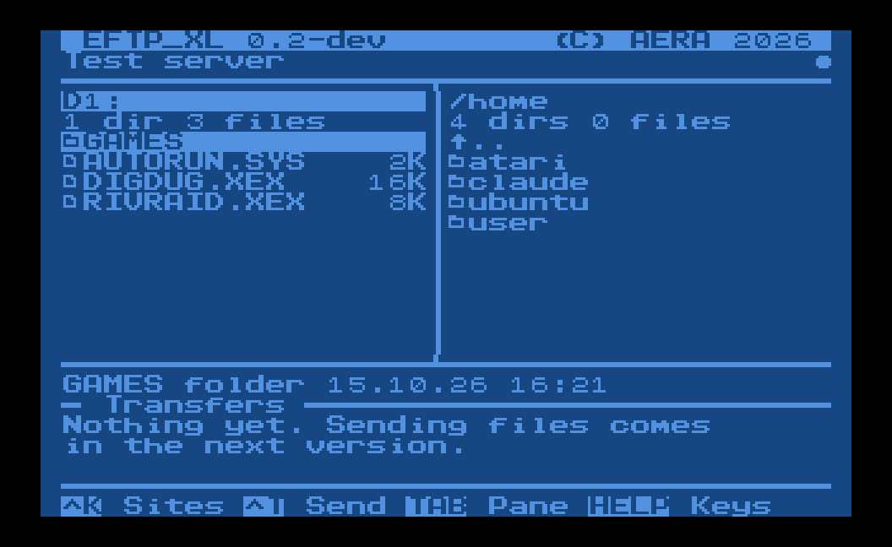

# EFTP_XL

File transfer for 8-bit Atari computers (400/800/XL/XE) over
[FujiNet](https://fujinet.online), written in C with cc65. Connects to any
FTP server (a Mac, a NAS, a Linux box) and moves files between it and your
Atari drives.

EFTP_XL has its own FTP client. It talks to the server over plain FujiNet
TCP connections (`N1:` for commands, `N2:` for data in passive mode), so it
works on FujiNet firmware 1.3 and later and logs in with your username and
password. FujiNet's built-in FTP protocol is not used: up to firmware 1.6.1
it always logs in as `anonymous` on port 21.

Works with DOS 2.5 and SpartaDOS 3.x. All local file access goes through CIO,
so any CIO-compatible DOS should work. Files are transferred as raw binary
with no conversion.

## Status

**Step 3.** The full-screen program, after EFTP on the ST, in EDOS's
font and colours: the Atari and the server side by side, and files going
both ways.



The design for the finished program, transfers included, is in
[docs/design](docs/design).

- [x] Log in and list a remote directory
- [x] Two panes: browse folders on the Atari (D1:-D8:, SpartaDOS
      folders) and on the server
- [x] Sites, saved in `EFTPXL.CFG`
- [x] Download and upload files, marked ones one after the other, with
      progress, speed, ESC to stop, and text line ends converted
- [x] New folder, rename, delete, on both sides
- [ ] Folders with everything in them

## The server

Any standard FTP server with passive mode works; tested with pure-ftpd and
pyftpdlib. On a Mac, pure-ftpd from Homebrew is a good choice. For a quick
test, pyftpdlib:

```sh
python3 -m venv ~/eftp-venv
~/eftp-venv/bin/pip install pyftpdlib
mkdir -p ~/AtariShare
~/eftp-venv/bin/python -m pyftpdlib -p 2121 -w -d ~/AtariShare -u ATARI -P SECRET
```

FTP is unencrypted, so only use it on your home network.

## Running on the Atari

1. Get `EFTPXL.XEX` from the
   [latest release](https://github.com/whomper/EFTP_XL/releases) onto a disk
   the Atari can read, e.g. an ATR on the FujiNet SD card or a TNFS share.
2. Turn BASIC off (hold OPTION while booting DOS 2.5): the program needs
   the 48K that leaves free. With BASIC on, the loader says there is not
   enough memory.
3. Load it: `L` from the DOS 2.5 menu, or type `EFTPXL` at the SpartaDOS
   prompt.
4. Press ^K for the sites, ^N to add one: a name, the server (IP address
   or name), port (21 unless your server uses another), user and
   password, the folder on the server to start in, and the folder on the
   Atari (e.g. `D1:>DOWNLOAD>`). RETURN on a site connects.

The screen, after EFTP: the Atari on the left, the server on the right,
the folder you are in above each, and the pane with the keyboard has its
header in inverse. Under the panes is the full name, size and date of the
file under the cursor, then the transfers.

| Key            | Does                                    |
|----------------|-----------------------------------------|
| ^K / ^D        | the sites (connect) / disconnect        |
| RETURN         | open the folder, send the file          |
| ^T             | send the marked files                   |
| ESC            | stop the transfer                       |
| BACKSPACE      | the folder up                           |
| TAB            | the other pane                          |
| ↑ ↓ (or - =)   | move; ← → (or + \*) a page              |
| A-Z            | the next name starting with the letter  |
| SPACE / ^A     | mark the file and move on / mark all    |
| 1-8            | drive D1:-D8: (in the Atari pane)       |
| ^N             | new folder                              |
| ^E             | rename                                  |
| DEL            | delete (the marked ones, or the one under the cursor) |
| ^R             | read both lists again                   |
| HELP (or ?)    | the keys                                |
| ^Q             | quit to DOS                             |

The keys are EFTP's.

**New folder, rename, delete.** ^N asks for a folder's name, ^E for a
new name (the old one to change), and DEL deletes the marked files and
folders, or the one under the cursor, after "Delete ...? Y/N". On the
server they are FTP's MKD, RNFR/RNTO, DELE and RMD; on the Atari the
DOS's XIO: rename (32) and delete (33) on any DOS, new folder (42) and
removing one (43) on SpartaDOS; DOS 2.5 has no folders, and EFTP_XL says
so. A folder has to be empty to be deleted, as DOS and FTP want. DEL is
Shift+Delete (or Ctrl+Delete).

**Sending files.** RETURN on a file sends it to the other side; mark
several with SPACE (or ^A for all) and ^T sends them, one after the
other. The transfers area shows them (Done, Waiting, a progress bar for
the one going), the info line the speed, and at the end "3 files, 260K
in 0:42 (6K/s)". ESC stops; a file stopped on its way to the Atari is
deleted rather than left half there.

- A file coming to the Atari gets a name DOS takes: up to 8 letters and
  digits and 3 for the extension, in capitals (`STinG 1.26.zip` becomes
  `STING126.ZIP`). Atari names go to the server as they are.
- When the file is already there, EFTP_XL asks before replacing it.
- The site's **Files** setting: *Binary* sends every byte as it is;
  *Text* changes the line ends (CR LF on the server, EOL on the Atari,
  and the TAB character); *By type* does that for EFTP's text types (TXT,
  ASC, DOC, ME, NFO, DIZ, HTM, HTML, INF) and LST, and sends the rest as
  binary.
- On DOS 2.5 a file's size is counted in sectors, so the size shown for
  an Atari file (and its progress) is close, not exact.

Notes:

- `EFTPXL.CFG` is on the drive (and SpartaDOS folder) you run EFTP_XL
  from, one line per site. A password saved there is plain text: leave it
  blank and EFTP_XL asks for it each time you connect.
- Usernames, passwords and paths are case-sensitive. The Atari keyboard
  starts in uppercase; press **CAPS** to switch to lowercase.
- A blank user logs in as `anonymous`.
- On an error the info line shows the server's own reply, for example
  `530 Login incorrect`.
- The program loads at `$2800`. If DOS's MEMLO is higher, the loader
  says "Program would load below MEMLO"; let me know your value and
  we'll adjust.

## Building

You need a recent [cc65](https://github.com/cc65/cc65) built from git (the
2.19 release is too old for fujinet-lib):

```sh
git clone https://github.com/cc65/cc65 && make -C cc65
export PATH="$PWD/cc65/bin:$PATH"

git clone --recurse-submodules https://github.com/whomper/EFTP_XL
cd EFTP_XL
make
```

The output is `bin/EFTPXL.XEX`. `START_ADDR` changes the load address, for
example `make START_ADDR=0x2800`. `bin/` and `dist/` are what make builds;
they are never committed.

**Testing without an Atari.** `tools/sim.py` runs the real
`bin/EFTPXL.XEX` on an emulated 6502 ([py65](https://github.com/mnaberez/py65)),
the way EDOS is tested. It stands in for the OS calls the program makes:
the screen (read from screen memory), the keyboard (typed from a
script), the disks (D1:, D2: are folders here, through CIO) and SIO as a
FujiNet whose `N1:`/`N2:` TCP connections are real sockets. So the
program's FTP client talks to a real server:

```sh
pip install py65 pillow
tools/sim.py --d1 disk --shots shot '^K^NTest\n192.168.1.20\n21\nATARI\nSECRET\n/\n\n\n\n\s'
```

The keys are what you would type (`\n` RETURN, `\e` ESC, `\t` TAB, `\b`
BACKSPACE, `\u` `\d` up and down, `\h` HELP, `^K` Ctrl+K), and `\s` takes
a snapshot: the screen as text, and `shot-N.png` as the Atari shows it.
`--dos dos2` lists D1: as DOS 2.5 does (SpartaDOS 3 otherwise), and
`--sio-log` shows every FTP command sent.

**Versions and releases.** `VERSION` in `src/main.c` holds the last
release, and a release build (`make RELEASE=1`) shows it at startup; any
other build shows `0.2-dev`. To release: raise `VERSION`, commit and push,
then run the Release workflow (Actions > Release > Run workflow, on main)
with what is new: [`.github/workflows/release.yml`](.github/workflows/release.yml)
builds cc65 (at a fixed commit) and the program, tags the commit `vX.Y`
and publishes `EFTPXL.XEX` as a GitHub Release (a pre-release while the
version is 0.x). Pushing a tag made with `git tag -a` does the same, with
the tag's message as the notes.

[fujinet-lib](https://github.com/FujiNetWIFI/fujinet-lib) is included as a
submodule (GPL-3.0).

## Licence

EFTP_XL is free software: you can redistribute it and/or modify it under
the terms of the GNU General Public License as published by the Free
Software Foundation, either version 2 of the License, or (at your option)
any later version. It is distributed in the hope that it will be useful,
but WITHOUT ANY WARRANTY; without even the implied warranty of
MERCHANTABILITY or FITNESS FOR A PARTICULAR PURPOSE. See [COPYING](COPYING).

Copyright (C) 2026 AERA | Erez Yaary.

`EFTPXL.XEX` is linked with fujinet-lib (GPL-3.0), so the built program
as a whole is distributed under the GPL version 3.
