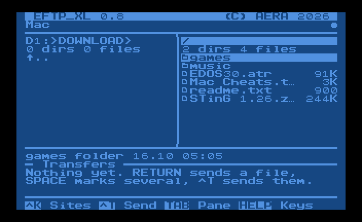
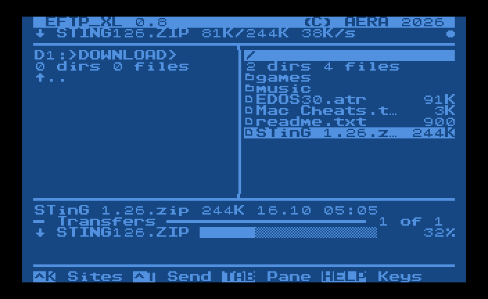
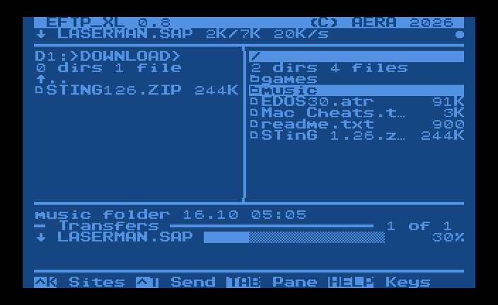
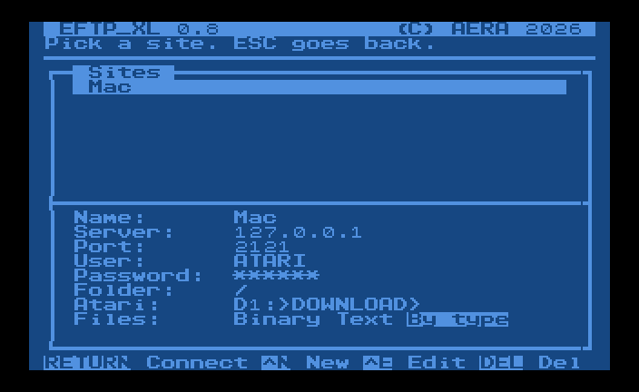
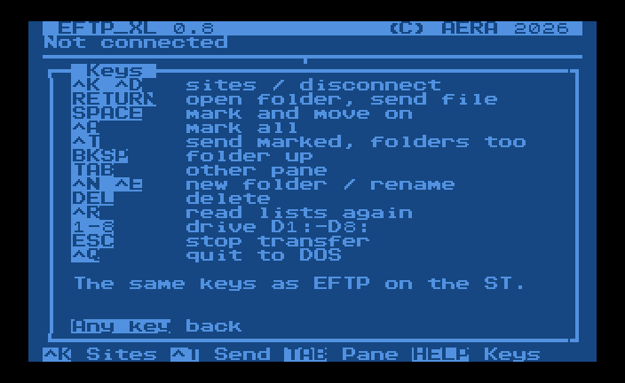
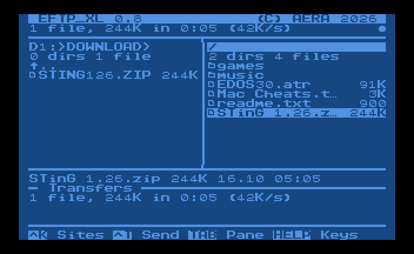
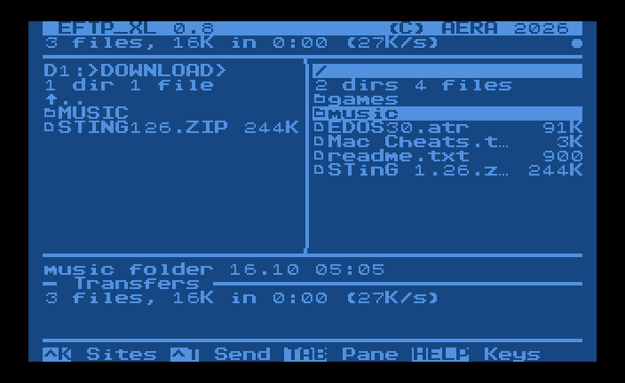
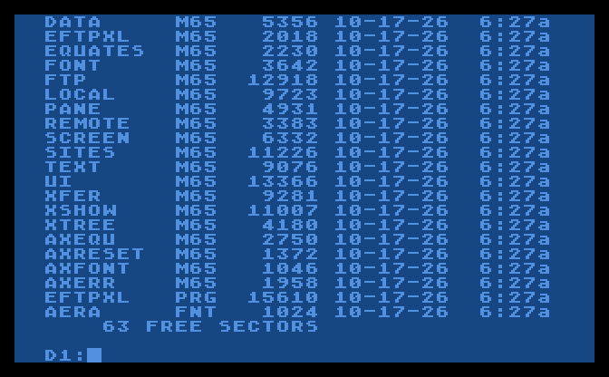
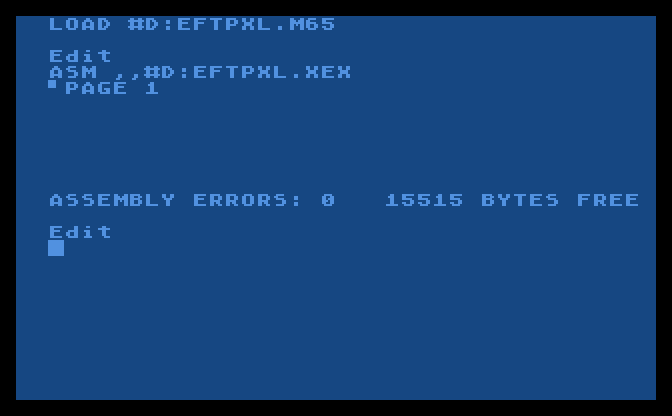

# EFTP_XL

File transfer for 8-bit Atari computers (400/800/XL/XE) over
[FujiNet](https://fujinet.online), written in 6502 assembly for Mac/65,
so it can be built on the Atari as well. Connects to any FTP server (a
Mac, a NAS, a Linux box) and moves files between it and your Atari
drives.

EFTP_XL has its own FTP client. It talks to the server over plain FujiNet
TCP connections (`N1:` for commands, `N2:` for data in passive mode), so it
works on FujiNet firmware 1.3 and later and logs in with your username and
password. FujiNet's built-in FTP protocol is not used: up to firmware 1.6.1
it always logs in as `anonymous` on port 21.

Works with DOS 2.5 and SpartaDOS 3.x. All local file access goes through CIO,
so any CIO-compatible DOS should work. Files go as they are, or as text
with their line ends changed (the site's Files setting).

## What it does

The full-screen program, after EFTP on the ST, in EDOS's font and
colours: the Atari on the left, the server on the right, the
transfers below.

| | |
|---|---|
|  |  |
| Connected: the Atari's folder and the server's | A file coming down: the bar, the speed |
|  |  |
| A folder coming down with all in it, one file after the other | The sites, saved in `EFTPXL.CFG` |

- Log in to any FTP server with your user and password, over FujiNet
- Two panes: the Atari (D1:-D8:, SpartaDOS folders) and the server
- Files both ways, marked ones one after the other, with progress,
  speed, ESC to stop, and text line ends changed when you want
- Folders both ways, with everything in them
- New folder, rename, delete, on both sides
- Sites, saved on the disk

The pictures are of the real program, run by `tools/sim.py` (see
[Testing](#testing)); `tools/screenshots.py` takes them again. The first
design is in [docs/design](docs/design).

## The server

Any standard FTP server with passive mode works; tested with pure-ftpd and
pyftpdlib. On a Mac, pure-ftpd from Homebrew is a good choice. For a quick
test, pyftpdlib:

```sh
python3 -m venv ~/eftp-venv
~/eftp-venv/bin/pip install pyftpdlib
mkdir -p ~/AtariShare
~/eftp-venv/bin/python -m pyftpdlib -p 2121 -w -d ~/AtariShare -u ATARI -P SECRET
```

FTP is unencrypted, so only use it on your home network.

## Running on the Atari

1. Get `EFTPXL.XEX` from the
   [latest release](https://github.com/whomper/EFTP_XL/releases) onto a disk
   the Atari can read, e.g. an ATR on the FujiNet SD card or a TNFS share.
2. Load it: `L` from the DOS 2.5 menu, or type `EFTPXL.XEX` at the
   SpartaDOS prompt.
3. Press ^K for the sites, ^N to add one: a name, the server (IP address
   or name), port (21 unless your server uses another), user and
   password, the folder on the server to start in, and the folder on the
   Atari (e.g. `D1:>DOWNLOAD>`). RETURN on a site connects.

The screen, after EFTP: the Atari on the left, the server on the right,
the folder you are in above each, and the pane with the keyboard has its
header in inverse. Under the panes is the full name, size and date of the
file under the cursor, then the transfers.

| Key            | Does                                    |
|----------------|-----------------------------------------|
| ^K / ^D        | the sites (connect) / disconnect        |
| RETURN         | open the folder, send the file          |
| ^T             | send the marked files and folders, or the one under the cursor |
| ESC            | stop the transfer                       |
| BACKSPACE      | the folder up                           |
| TAB            | the other pane                          |
| ↑ ↓ (or - =)   | move; ← → (or + \*) a page              |
| A-Z            | the next name starting with the letter  |
| SPACE / ^A     | mark and move on / mark all the files   |
| 1-8            | drive D1:-D8: (in the Atari pane)       |
| ^N             | new folder                              |
| ^E             | rename                                  |
| DEL            | delete (the marked ones, or the one under the cursor) |
| ^R             | read both lists again                   |
| HELP (or ?)    | the keys                                |
| ^Q             | quit to DOS                             |

The keys are EFTP's; HELP shows them:



**New folder, rename, delete.** ^N asks for a folder's name, ^E for a
new name (the old one to change), and DEL deletes the marked files and
folders, or the one under the cursor, after "Delete ...? Y/N". On the
server they are FTP's MKD, RNFR/RNTO, DELE and RMD; on the Atari the
DOS's XIO: rename (32) and delete (33) on any DOS, new folder (42) and
removing one (43) on SpartaDOS; DOS 2.5 has no folders, and EFTP_XL says
so. A folder has to be empty to be deleted, as DOS and FTP want. DEL is
Shift+Delete (or Ctrl+Delete).

**Sending files.** RETURN on a file sends it to the other side; mark
several with SPACE (or ^A for all) and ^T sends them, one after the
other. The transfers area shows them (Done, Waiting, a progress bar for
the one going), the info line the speed, and at the end "3 files, 260K
in 0:42 (6K/s)". ESC stops; a file stopped on its way to the Atari is
deleted rather than left half there.



**Sending folders.** Mark a folder with SPACE (or put the cursor on it)
and ^T sends it with everything in it, folders in folders too (8 deep
at most). It is made on the other side, or gone into when it is there
already; files already there are asked about, as at the top. Going to
the Atari, a folder gets an 8.3 name as files do, which needs
SpartaDOS: DOS 2.5 has no folders. The summary counts the files.



- A file coming to the Atari gets a name DOS takes: up to 8 letters and
  digits and 3 for the extension, in capitals (`STinG 1.26.zip` becomes
  `STING126.ZIP`). Atari names go to the server as they are.
- When the file is already there, EFTP_XL asks before replacing it.
- The site's **Files** setting: *Binary* sends every byte as it is;
  *Text* changes the line ends (CR LF on the server, EOL on the Atari,
  and the TAB character); *By type* does that for EFTP's text types (TXT,
  ASC, DOC, ME, NFO, DIZ, HTM, HTML, INF) and LST, and sends the rest as
  binary.
- On DOS 2.5 a file's size is counted in sectors, so the size shown for
  an Atari file (and its progress) is close, not exact. SpartaDOS gives
  the size in bytes, and its folders.

Notes:

- `EFTPXL.CFG` is on the drive (and SpartaDOS folder) you run EFTP_XL
  from, one line per site. A password saved there is plain text: leave it
  blank and EFTP_XL asks for it each time you connect.
- Usernames, passwords and paths are case-sensitive. The Atari keyboard
  starts in uppercase; press **CAPS** to switch to lowercase.
- A blank user logs in as `anonymous`.
- On an error the info line shows the server's own reply, for example
  `530 Login incorrect`.
- The program takes `$4000`-`$978F`: above EDOS (`$1E00`-`$3752`) and
  the MEMLO of DOS 2.5 and SpartaDOS 3, and below a cartridge, so BASIC
  can stay on. If a DOS's MEMLO is above `$4000`, the program says so
  and goes back to DOS before loading itself.

## Building

The program is 6502 assembly in Mac/65's form, in [ASM](ASM):
`EFTPXL.ASM` is the main file and includes the others. It is 13.8K, the
font included; the first version, in C with cc65, was 27K, and is kept
in [C](C) for reference.

**On another computer** with [ATasm](https://github.com/CycoPH/atasm), a
cross-assembler that takes Mac/65's source:

```sh
git clone https://github.com/CycoPH/atasm && make -C atasm/src
export PATH="$PWD/atasm/src:$PATH"

git clone https://github.com/whomper/EFTP_XL
cd EFTP_XL
make            # bin/EFTPXL.XEX
make atr        # bin/EFTPXL-SRC.ATR: the sources, for the Atari
```

`bin/` and `dist/` are what make builds; they are never committed.

**On the Atari** with Mac/65. `make atr` makes `EFTPXL-SRC.ATR`, a
SpartaDOS double density disk that boots SpartaDOS 3.2 and holds the
program and its sources in Mac/65's own tokenized form (`.M65`, as its
SAVE writes them), ready to LOAD. A release has this disk too.

1. Boot the disk in D1: with the Mac/65 cartridge in (`EFTPXL.XEX` at
   the SpartaDOS prompt runs the program; `CAR` goes to Mac/65). Mac/65's
   `D:` is D1:; to work from another disk, copy the files to D1:'s
   current folder.
2. In Mac/65:

   ```
   LOAD #D:EFTPXL.M65
   ASM ,,#D:EFTPXL.XEX
   ```

   `EFTPXL.M65` is the main file; Mac/65 reads the parts it includes
   from `D:` as it assembles. Load the main file first and give no
   source to `ASM`: on SpartaDOS, Mac/65 1.01 can't assemble a main
   file read from disk (as EDOS found). With SpartaDOS 3.2 it reports
   `ASSEMBLY ERRORS: 0` with about 15K free.

| | |
|---|---|
|  |  |
| The source disk booted: SpartaDOS 3.2, the sources, the program | MAC/65 1.01 building EFTP_XL from it |

These two are from the atari800 emulator, running SpartaDOS 3.2 from
the disk and the MAC/65 1.01 cartridge.

Each `.M65` can be LOADed to read or change it, and SAVEd back.
`tools/mac65tok.py` (EDOS's, with the tokens EFTP_XL uses as well)
writes them: they are the same, byte for byte, as Mac/65 1.01 saves
after ENTERing the text, and Mac/65 1.01 builds the same program from
them as ATasm does. That was checked by running the cartridge in the
atari800 emulator; the cartridge isn't in this repository.

The source keeps to what Mac/65 and ATasm both take: labels of letters
and digits, `*=*+n` for room (no `.DS`), the font as `.BYTE` lines (no
`.INCBIN`), `[ ]` around expressions, one level of `.INCLUDE`. ATasm
builds the same program from the files on that disk, turned back into
text (`make atr` checks this is so with `tools/atari_src.py --check`).

## Testing

**The program on an emulated 6502.** `tools/sim.py` runs the real
`bin/EFTPXL.XEX` on [py65](https://github.com/mnaberez/py65), the way
EDOS is tested. It stands in for the OS calls the program makes: the
screen (read from screen memory), the keyboard (typed from a script),
the disks (D1:, D2: are folders here, through CIO, listed as SpartaDOS
3 or DOS 2.5 list them) and SIO as a FujiNet whose `N1:`/`N2:` TCP
connections are real sockets. So the program's FTP client talks to a
real server:

```sh
pip install py65 pillow
make && tools/sim.py --d1 disk --shots shot '^K^NTest\n192.168.1.20\n21\nATARI\nSECRET\n/\n\n\n\n\s'
```

The keys are what you would type (`\n` RETURN, `\e` ESC, `\t` TAB, `\b`
BACKSPACE, `\u` `\d` up and down, `\h` HELP, `^K` Ctrl+K); `\s` takes a
snapshot (the screen as text, and `shot-N.png` as the Atari shows it),
`\w` waits for a transfer to end and `\z` lets one block of it go by.
`--dos dos2` lists D1: as DOS 2.5 does, and `--sio-log` shows every FTP
command sent.

**The checks.** `make test` (`tools/test_sim.py`, with `pip install py65
pyftpdlib`) runs the program that way against an FTP server it starts,
and looks at the screen and at the files on both sides, 32 checks:

| | |
|---|---|
| Sites | a site made and saved in `EFTPXL.CFG`; connecting |
| Panes | both lists, sizes in bytes, the server's folder, into and out of folders on both sides |
| Files | down and up byte for byte, binary and text (line ends changed), the sums; the replace question; ESC stops and leaves no half file |
| Folders | a server folder two folders deep down to the Atari, an Atari folder with one in it up to the server, both panes back where they were |
| New, rename, delete | folders and files on the Atari and on the server |
| DOS 2.5 | its listing; no folders made, none sent |

CI (`.github/workflows/ci.yml`) builds the program and the source disk
(checking the disk gives the same program) and runs these on every
push.

**With the Atari's own software.** Before a release the program also
runs in the [atari800](https://atari800.github.io) emulator (its
library, driven by a script), with the Atari's own OS and DOS instead
of stand-ins: SpartaDOS 3.2 booted from `EFTPXL-SRC.ATR`, EFTP_XL run
from its prompt, and the MAC/65 1.01 cartridge assembling the disk's
sources. That is how the SpartaDOS directory fixed in 0.6 was found.
The cartridge isn't in this repository, so this isn't part of CI.

**On real hardware.** Each release says whether it has been.

## Versions and releases

`VERSION` in `ASM/EFTPXL.ASM` holds the last
release, and every build shows it at startup (there is no `-dev`
label). Only releases leave the build machine. To release: raise `VERSION`, commit and push,
then run the Release workflow (Actions > Release > Run workflow, on main)
with what is new: [`.github/workflows/release.yml`](.github/workflows/release.yml)
builds ATasm (at a fixed commit) and the program, tags the commit `vX.Y`
and publishes `EFTPXL.XEX` and the source disk as a GitHub Release, marked
Latest. Pushing a tag made with `git tag -a` does the same, with
the tag's message as the notes.

The C version in `C/` uses [fujinet-lib](https://github.com/FujiNetWIFI/fujinet-lib),
a submodule (GPL-3.0); the program in assembly uses no library.

## Licence

EFTP_XL is free software: you can redistribute it and/or modify it under
the terms of the GNU General Public License as published by the Free
Software Foundation, either version 2 of the License, or (at your option)
any later version. It is distributed in the hope that it will be useful,
but WITHOUT ANY WARRANTY; without even the implied warranty of
MERCHANTABILITY or FITNESS FOR A PARTICULAR PURPOSE. See [COPYING](COPYING).

Copyright (C) 2026 AERA | Erez Yaary.

The C version, linked with fujinet-lib (GPL-3.0), is distributed as a
whole under the GPL version 3.

`EFTPXL-SRC.ATR` carries SpartaDOS 3.2 (`tools/disk/X32G.DOS`) and its
boot sectors (`tools/disk/SPARTA.BOOT`), as EDOS's disks do; they stay
under their own terms.
`tools/sparta.py` and `tools/mac65tok.py` are EDOS's.
