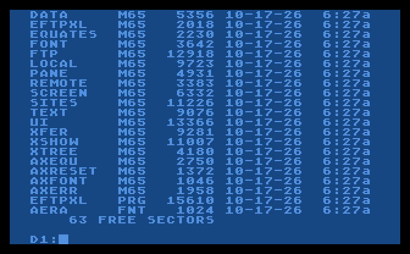
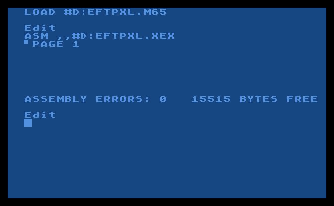

# Developing EFTP_XL

Building on another computer and on the Atari, the source's rules, the tests and how a release is made. The short version is the [README](../README.md).

## Building

The program is 6502 assembly in Mac/65's form, in [ASM](../ASM):
`EFTPXL.M65` is the main file and includes the others. It is 15.6K (the
font is `AERA.FNT`, read when it is there); the first version, in C with
cc65, was 27K (it is in the git history, up to v0.2).

**On another computer** with Python 3. The cross-assembler is
`xl/tools/mac65.py`, from the AERA 8-bit shared tools (`xl/`, below),
which makes the same program as Mac/65 1.01, byte for byte:

```sh
git clone https://github.com/whomper/EFTP_XL
cd EFTP_XL
pip install -r xl/requirements.txt -r requirements.txt
make            # bin/EFTPXL.COM
make atr        # bin/EFTPXL.ATR: the disk, with the sources for the Atari
make test       # all the checks (Tests, below)
make dist       # a release's files in dist/
```

`bin/` and `dist/` are what make builds; they are never committed.

**On the Atari** with Mac/65. `EFTPXL.ATR` is a SpartaDOS double density
disk that boots SpartaDOS 3.2 and holds the program, `AERA.FNT` and the
sources in Mac/65's own tokenized form, with line numbers (`.M65`, as
its SAVE writes them), ready to LOAD: EFTP_XL's own files and the
shared `AX*.M65` it includes. A release has this disk.

1. Boot the disk in D1: with the Mac/65 cartridge in (`EFTPXL.COM` at
   the SpartaDOS prompt runs the program; `CAR` goes to Mac/65). Mac/65's
   `D:` is D1:; to work from another disk, copy the files to D1:'s
   current folder.
2. In Mac/65:

   ```
   LOAD #D:EFTPXL.M65
   ASM ,,#D:EFTPXL.COM
   ```

   This makes `EFTPXL.COM`, the program, over the one on the disk: the
   same bytes as the release's, in Mac/65's smaller segments.
   `EFTPXL.M65` is the main file; Mac/65 reads the parts it includes
   from `D:` as it assembles. Load the main file first and give no
   source to `ASM`: on SpartaDOS, Mac/65 1.01 can't assemble a main
   file read from disk (as EDOS found). With SpartaDOS 3.2 it reports
   `ASSEMBLY ERRORS: 0` with about 13K free. Write the program over
   `EFTPXL.COM` (or to another disk): the disk has no room for a second
   copy.

| | |
|---|---|
|  |  |
| The source disk booted: SpartaDOS 3.2, the sources, the program | MAC/65 1.01 building EFTP_XL from it |

These two are from the atari800 emulator, running SpartaDOS 3.2 from
the disk and the MAC/65 1.01 cartridge.

Each `.M65` can be LOADed to read or change it, and SAVEd back;
`xl/tools/atari_src.py import` brings a file saved on the Atari back
into git's form, without the line numbers. `make atr` writes the disk
with `xl/tools/atari_src.py`: the files are the same, byte for byte, as
Mac/65 1.01 saves after ENTERing the text, and `make atr` checks that
the sources on the disk give the same program. That was also checked by
running the cartridge in the atari800 emulator; the cartridge isn't in
this repository.

## Source

```
ASM/        the program: EFTPXL.M65, the main file, and its parts
xl/         the AERA 8-bit shared code and tools, from AERA-Atari
            (read-only here; tools/sync-xl.sh brings it up to date)
  src/      AX*.M65: the OS's names, the load check, RESET, AERA.FNT,
            CIO's error texts
  font/     AERA.FNT, the family's font
  tools/    mac65.py (the assembler), atari_src.py (the disk), font.py,
            a8sim (the simulator), atari800/ (the checks in atari800)
  workflows/ release.yml and withdraw.yml, copied to .github/workflows
tools/      sim.py (the program on xl's a8sim), fujinet.py (its FujiNet),
            test_sim.py, screenshots.py, testdisk.py (EFTPTEST.ATR's
            files), gwserve.py (the gateway the SFTP checks use),
            sync-xl.sh
docs/       MANUAL.md, DEVELOPMENT.md (this), the icon, the pictures,
            the first design, TESTPLAN.TXT (the test plan)
```

The source keeps to what Mac/65 1.01 takes: labels of letters and
digits, `*=*+n` for room (no `.DS`), no `.INCBIN`, `[ ]` around
expressions, one level of `.INCLUDE`, and a zero-page name defined
before it is used. Each file starts with a header naming it and the
version; each routine has a few lines on what it
does, what it takes and what it gives back.

## Tests

**The program on an emulated 6502.** `tools/sim.py` runs the real
`bin/EFTPXL.COM` on xl's `a8sim` (`xl/tools/a8sim`, on
[py65](https://github.com/mnaberez/py65)), the simulator EDOS's tests
use too, with EFTP_XL's FujiNet (`tools/fujinet.py`). It stands in for
the OS calls the program makes: the
screen (read from screen memory), the keyboard (typed from a script),
RESET, the disks (D1:, D2: are folders here, through CIO, listed as
SpartaDOS 3 or DOS 2.5 list them) and SIO as a FujiNet whose `N1:`/`N2:`
TCP connections are real sockets, taking only the frame lengths a real
FujiNet takes. So the program's FTP client talks to a real server:

```sh
make && tools/sim.py --d1 disk --shots shot '^K^NTest\n192.168.1.20\n21\nATARI\nSECRET\n/\n\n\n\n\s'
```

The keys are what you would type (`\n` RETURN, `\e` ESC, `\t` TAB, `\b`
BACKSPACE, `\u` `\d` up and down, `\h` HELP, `\!` RESET, `^K` Ctrl+K);
`\s` takes a snapshot (the screen as text, and `shot-N.png` as the Atari
shows it), `\w` waits for a transfer to end and `\z` lets one block of
it go by. `--dos dos2` lists D1: as DOS 2.5 does, and `--sio-log` shows
every FTP command sent.

**The checks.** `make test` runs xl's own tests, then
`tools/test_sim.py`: the program that way against an FTP server it
starts, looking at the screen, at memory and at the files on both
sides, 121 checks:

| | |
|---|---|
| Sites | a site made and saved in `EFTPXL.CFG`, the note on top, notes skipped, 1.2's file read; edited, added, deleted in order; no room; connecting |
| Panes | both lists, sizes in bytes, the server's folder, into and out of folders on both sides |
| Files | down and up byte for byte, binary and text (line ends changed), the sums; the replace question, and All; ESC stops and leaves no half file |
| Folders | a server folder two folders deep down to the Atari, an Atari folder with one in it up to the server, both panes back where they were |
| New, rename, delete | folders and files on the Atari and on the server |
| DOS 2.5 | its listing; no folders made, none sent, and the error's text |
| RESET | back to the main screen, disconnected, `N1:` and `N2:` closed, the keys working; ^Q still back to DOS |
| HELP, the font | the About lines; `AERA.FNT` read below the screen and its icons used, set again after RESET without reading it again, DOS's font back on quit; without it the ROM font and its icons; no font in the program |
| ESC and BREAK | each cancels as "no": new folder, rename, delete, HELP, the Sites screen, a site's edit, delete and new, the replace question, the password question; each stops a transfer |
| The test disk | `EFTPTEST.ATR` clean, with the files the test plan needs |
| Disk access | 20K down and up, binary and text: the file opened once, 2 PUTs or GETs with BASIC off and 3 on, through the memory above the program; nothing below MEMLO and not the font changed; with MEMTOP just above the program, 256 bytes at a time; after an upload the Atari not read again; a site saved not read back |
| Loading | the load check refuses a DOS whose MEMLO is above `$1E00`, says so and goes back to DOS |
| SFTP, FTPS | through AERA-Gateway's eftpgate (its latest release, fetched by `make test`) to the SFTP and FTPS servers of its own tests: ^G's gateway and the site saved, no gateway said, the list, text down and up with the server's line ends, binary both ways |

CI (`.github/workflows/ci.yml`) builds the program and the disk
(checking the disk gives the same program) and runs these on every
push.

**With the Atari's own software.** Before a release the program also
runs in the [atari800](https://atari800.github.io) emulator (its
library, driven by a script), with the Atari's own OS and DOS instead
of stand-ins: SpartaDOS 3.2 booted from `EFTPXL.ATR`, EFTP_XL run
from its prompt and RESET pressed, and the MAC/65 1.01 cartridge
assembling the disk's sources. That is how the SpartaDOS directory fixed
in 0.6 was found. The cartridge isn't in this repository, so this isn't
part of CI.

**On real hardware.** `EFTPTEST.ATR`, in each release, is a bootable
SpartaDOS 3.2 disk with the program, `AERA.FNT`, a site to fill in
(`PI_IP`), the files to send (text, binary, empty, 64K, a folder with a
folder in it) and `TESTPLAN.TXT`, the test plan in 38 columns: `TYPE
TESTPLAN.TXT` on the Atari. Its source is
[docs/TESTPLAN.TXT](TESTPLAN.TXT). Each release says whether it has
been tried.

## Releases

`VERSION` in `ASM/EFTPXL.M65` holds the last release, and every build
shows it at startup (there is no `-dev` label); every source file's
header repeats it. Only releases leave the build machine. To release:
raise the version, commit and push, then run the Release workflow
(Actions > Release > Run workflow, on main) with what is new:
[`.github/workflows/release.yml`](../.github/workflows/release.yml) (the
AERA 8-bit one, from `xl/`) runs `make test` and `make dist`, tags the
commit `vX.Y` and publishes `EFTPXL.COM`, `EFTPXL.ATR`, `AERA.FNT` and
`EFTPTEST.ATR` as
a GitHub Release, marked Latest. Pushing a tag made with `git tag -a`
does the same, with the tag's message as the notes. A release that must
not be used is marked with the Withdraw workflow
([`.github/workflows/withdraw.yml`](../.github/workflows/withdraw.yml)):
a notice at the top of its notes names the release to use instead.

## The README's pictures

The pictures are of the real program, run by `tools/sim.py` (see
[Tests](#tests)); `tools/screenshots.py` takes them again. The first
design is in [docs/design](design).
