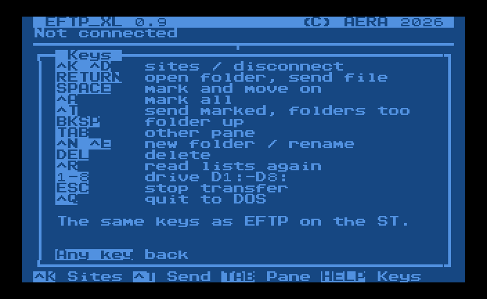
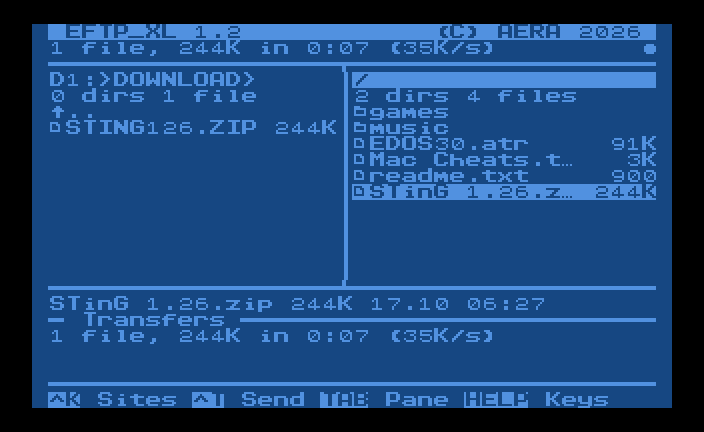
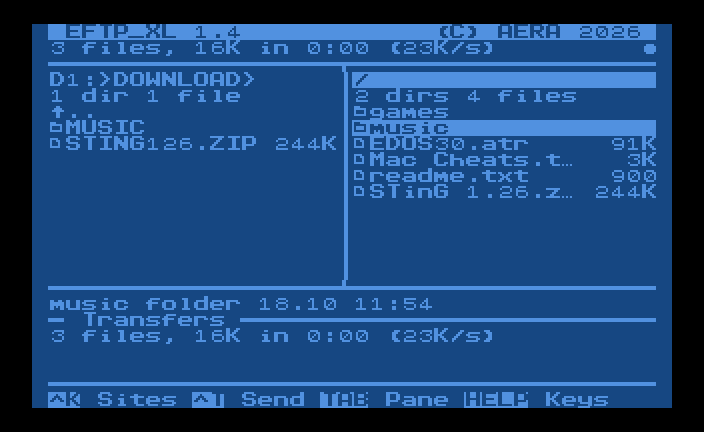

# Using EFTP_XL

The full manual: setting up, the screen and its keys, sending files and folders, the sites file, and how EFTP_XL reaches FTP, SFTP and FTPS servers. The short version is the [README](../README.md).

## Setting up

1. Get `EFTPXL.COM` and `AERA.FNT` from the
   [latest release](https://github.com/whomper/EFTP_XL/releases) onto a
   disk the Atari can read, e.g. an ATR on the FujiNet SD card or a TNFS
   share. `EFTPXL.ATR`, also in the release, is a bootable SpartaDOS 3.2
   disk with both on it (and the sources).
2. Load it: `L` from the DOS 2.5 menu, or type `EFTPXL.COM` at the
   SpartaDOS prompt. EFTP_XL looks for `AERA.FNT` and its sites
   (`EFTPXL.CFG`) on `D:`, the DOS's current drive and folder, not where
   the program was loaded from: on DOS 2.5 that is always D1:, on
   SpartaDOS the drive and folder of the prompt.
3. Press ^K for the sites, ^N to add one: a name, the server (IP address
   or name), the port (blank: 21, or 22 for SFTP), your user (blank:
   `anonymous`), the password (blank: asked for each time you connect),
   the folder on the server to start in (blank: the one the server logs
   you in to), the folder on the Atari (e.g. `D1:>DOWNLOAD>`; blank: the
   one shown), how files are sent (**Files**, below) and the
   **Protocol**: FTP, or SFTP or FTPS through the Pi gateway
   ([below](#sftp-and-ftps)). A name holds up to 15 characters, the
   server 31, the user and the password 19 each, the server's folder 39
   and the Atari's 23. RETURN on a site connects.

**Updating.** Copy the new release's `EFTPXL.COM` and `AERA.FNT` over
the old ones (up to 1.4 the program was `EFTPXL.PRG`: delete that one).
Keep `EFTPXL.CFG`: every release since 0.3 writes its sites the same
way, so the new one reads them as they are.

**The font.** `AERA.FNT` is the font the AERA 8-bit programs share. It
isn't in the program: when it is on `D:`, EFTP_XL reads it into the
1K just below the screen, as EDOS does, and uses its icons: a folder, a
file, the "..." of a name cut short and the empty part of a progress
bar. Without it EFTP_XL runs in the Atari's own font, with characters
of that font for the icons: a folder is `▶`, the "..." is `→`, a file
has none and the bar is drawn with `─`.

The screen, after EFTP: the Atari on the left, the server on the right,
the folder you are in above each, and the pane with the keyboard has its
header in inverse. Under the panes is the full name, size and date of the
file under the cursor, then the transfers.

| Key            | Does                                    |
|----------------|-----------------------------------------|
| ^K / ^D        | the sites (connect) / disconnect        |
| RETURN         | open the folder, send the file          |
| ^T             | send the marked files and folders, or the one under the cursor |
| ESC (or BREAK) | stop the transfer; cancel any question, typed name or box, as "no": nothing is changed |
| BACKSPACE      | the folder up                           |
| TAB            | the other pane                          |
| ↑ ↓ (or - =)   | move; ← → (or + \*) a page              |
| A-Z            | the next name starting with the letter  |
| SPACE / ^A     | mark and move on / mark all the files   |
| 1-8            | drive D1:-D8: (in the Atari pane)       |
| ^N             | new folder                              |
| ^E             | rename                                  |
| DEL            | delete (the marked ones, or the one under the cursor) |
| ^R             | read both lists again                   |
| HELP (or ?)    | the keys, and what EFTP_XL is           |
| RESET          | back to the main screen, disconnected   |
| ^Q             | quit to DOS                             |

The keys are mostly EFTP's; HELP shows them:



**New folder, rename, delete.** ^N asks for a folder's name, ^E for a
new name (the old one to change), and DEL deletes the marked files and
folders, or the one under the cursor, after "Delete ...? Y/N". On the
server they are FTP's MKD, RNFR/RNTO, DELE and RMD; on the Atari the
DOS's XIO: rename (32) and delete (33) on any DOS, new folder (42) and
removing one (43) on SpartaDOS; DOS 2.5 has no folders, and EFTP_XL says
so. A folder has to be empty to be deleted, as DOS and FTP want. DEL is
Shift+Delete (or Ctrl+Delete).

**Sending files.** RETURN on a file sends it to the other side; mark
several with SPACE (or ^A for all) and ^T sends them, one after the
other. The transfers area shows them (Done, Waiting, a progress bar for
the one going), the info line the speed, and at the end "3 files, 260K
in 0:42 (6K/s)". A file that is there already asks "Replace? Y/N/All":
A replaces it and the rest of them without asking again. ESC stops; a
file stopped on its way to the Atari is deleted rather than left half
there. After it, the side the files went to is read again.



**Sending folders.** Mark a folder with SPACE (or put the cursor on it)
and ^T sends it with everything in it, folders in folders too (8 deep
at most). It is made on the other side, or gone into when it is there
already; files already there are asked about, as single files are.
Going to the Atari, a folder gets an 8.3 name as files do, which needs
SpartaDOS: DOS 2.5 has no folders. The summary counts the files.



- A file coming to the Atari gets a name DOS takes: up to 8 letters and
  digits and 3 for the extension, in capitals (`STinG 1.26.zip` becomes
  `STING126.ZIP`). Atari names go to the server as they are.
- When the file is already there, EFTP_XL asks before replacing it.
- The site's **Files** setting: *Binary* sends every byte as it is;
  *Text* changes the line ends (CR LF on the server, EOL on the Atari,
  and the TAB character); *By type* does that for EFTP's text types (TXT,
  ASC, DOC, ME, NFO, DIZ, HTM, HTML, INF) and LST, and sends the rest as
  binary.
- On DOS 2.5 a file's size is counted in sectors, so the size shown for
  an Atari file (and its progress) is close, not exact. SpartaDOS gives
  the size in bytes, and its folders.

Notes:

- `EFTPXL.CFG` is on `D:` (see [Setting up](#setting-up)),
  one line per site. A password saved there is plain text: leave it
  blank and EFTP_XL asks for it each time you connect.
- Usernames, passwords and paths are case-sensitive. The Atari keyboard
  starts in uppercase; press **CAPS** to switch to lowercase.
- A blank user logs in as `anonymous`.
- On an error the info line says what went wrong: the server's own
  reply (`530 Login incorrect`), or the Atari's own error with its text
  (`NOTES.TXT: Disk full`).
- The program takes `$1E00`-`$770C` (the program and its variables),
  over EDOS and above the MEMLO of DOS 2.5 (`$1CFC`) and SpartaDOS 3.2
  (`$17A2`), and the font the 1K just below the screen (`$9800` with
  BASIC on, `$B800` with it off), so BASIC can stay on. If a DOS's
  MEMLO is above `$1E00` (DOS 2.5 with the 850's R: handler, for one),
  or there isn't room, the program says so and goes back to DOS before
  loading itself.
- A file goes to and from the disk through all the memory between the
  program and the font, `$7800` up: 8K with BASIC on, 16K with it off,
  one PUT or GET for all it holds (a 20K file is 3 with BASIC on, 2
  off), and each file is opened once. A site saved writes
  `EFTPXL.CFG` and nothing reads it back.
- `EFTPXL.CFG` starts with a note on what it is; lines that start with
  `;` are notes, and EFTP_XL skips them. A line that starts with `@` is
  the Pi gateway (`@192.168.1.5:2121`). It holds up to 8 sites, as long
  as their lines fit in 640 bytes (about 80 each).

## How it reaches the servers

EFTP_XL has its own FTP client. It talks to the server over plain FujiNet
TCP connections (`N1:` for commands, `N2:` for data in passive mode), so it
works on FujiNet firmware 1.3 and later and logs in with your username and
password. FujiNet's built-in FTP protocol is not used: up to firmware 1.6.1
it always logs in as `anonymous` on port 21.

Any standard FTP server with passive mode works; tested with pure-ftpd and
pyftpdlib. On a Mac, pure-ftpd from Homebrew is a good choice. For a quick
test, pyftpdlib (then the site's port is 2100):

```sh
python3 -m venv ~/eftp-venv
~/eftp-venv/bin/pip install pyftpdlib
mkdir -p ~/AtariShare
~/eftp-venv/bin/python -m pyftpdlib -p 2100 -w -d ~/AtariShare -u ATARI -P SECRET
```

FTP is unencrypted: the user, the password and the files go across in
plain text, so only use it on your home network. For servers on the
internet use SFTP or FTPS, below. (2121, pyftpdlib's own default port,
is the Pi gateway's, hence 2100 above.)

### SFTP and FTPS

SSH and TLS are far beyond a 6502, so for SFTP and FTPS servers EFTP_XL
goes through the AERA Pi gateway: `eftpgate`, from
[AERA-Gateway](https://github.com/whomper/AERA-Gateway), on a Raspberry
Pi on your home network. The Atari speaks plain FTP to the Pi, and the
Pi speaks SFTP or FTPS to the server, checking its certificate or SSH
key. It is the same gateway EFTP uses on the ST.

```
Atari (EFTP_XL) --plain FTP, home network--> Pi (eftpgate) --SFTP or FTPS--> the server
```

1. On the Pi, from AERA-Gateway: `sudo gateway/aera-gateway install ftp`
   (port 2121, and 30000-30099 for data).
2. In EFTP_XL's sites (^K), ^G sets the gateway: the Pi's address, and
   `:port` if it isn't 2121 (`192.168.1.5`, or `192.168.1.5:2121`).
3. Give the site the server's own name, port, user and password, and
   SFTP or FTPS as its **Protocol**.

EFTP_XL then connects to the Pi and logs in as `sftp:user@server:port`
(or `ftps:`), the way eftpgate takes it, with the site's password; you
type none of that. Through the gateway a text file goes as FTP's text
(TYPE A), so it gets the server's own line ends (LF on SFTP), and
binary files as they are. A server on your home network (a NAS) needs
eftpgate's `--allow-local`.
